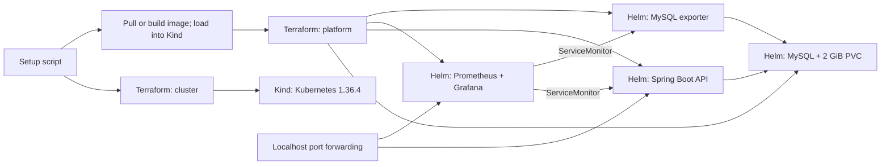

# Crewmeister DevOps assessment

Run the Java 17 / Spring Boot API and MySQL on local Kubernetes using Docker, Kind, Terraform and Helm. Prometheus and Grafana are included. No cloud account is required.

The [original assessment](docs/assessment.md) is preserved separately. See [validation evidence](docs/validation.md) for checks performed and limitations.

## Quick start

Install the prerequisites below and start Docker with Linux containers.

**Windows PowerShell 5.1 or later:**

```powershell
git clone https://github.com/ouemnaa/crewmeister-devops-challenge.git
cd crewmeister-devops-challenge
.\scripts\setup.ps1
.\scripts\verify.ps1
# When finished; deletes the project database:
.\scripts\down.ps1
```

If execution policy blocks scripts, use a separate process, for example `powershell -ExecutionPolicy Bypass -File .\scripts\setup.ps1`. No machine-wide policy change is needed.

**Linux, macOS or WSL with Bash:**

```bash
git clone https://github.com/ouemnaa/crewmeister-devops-challenge.git
cd crewmeister-devops-challenge
bash scripts/setup.sh
bash scripts/verify.sh
# When finished; deletes the project database:
bash scripts/down.sh
```

Setup creates the `crewmeister` cluster and four Terraform-managed Helm releases. Initial downloads can take 10-20 minutes or longer on a slow connection. Setup and teardown use Terraform `-auto-approve` for this dedicated environment. Teardown checks ownership, cluster identity, API address and certificate before applying saved destroy plans.

## Prerequisites

Put these tools on `PATH`:

| Tool | Version used | Installation |
| --- | --- | --- |
| Docker Engine / Desktop | Engine 28.0.4 | [Docker](https://docs.docker.com/engine/install/); Linux containers required |
| Terraform | **1.15.8** | [HashiCorp releases](https://releases.hashicorp.com/terraform/1.15.8/) |
| Kind | **0.33.0** | [Kind releases](https://github.com/kubernetes-sigs/kind/releases/tag/v0.33.0) |
| kubectl | **1.36.4** | [kubectl](https://kubernetes.io/docs/tasks/tools/); 1.35-1.37 clients also accepted |
| Helm | **4.3.1** | [Helm release](https://github.com/helm/helm/releases/tag/v4.3.1) |
| Git | Git 2.x | [Git](https://git-scm.com/downloads) |
| Bash and curl | Bash 3.2+, curl 7+ | Required for Bash scripts; WSL needs Docker Desktop integration |

Choose binaries matching your OS/CPU and verify publisher checksums. Provider locks cover Windows amd64, Linux amd64/arm64 and macOS amd64/arm64. Java 17 is needed only for direct tests: Docker includes the JDK and uses the checked-in Maven wrapper.

Allocate at least 4 CPUs and 6 GiB RAM to Docker; 8 GiB is more comfortable during builds. GitHub, Maven Central, chart repositories and container registries must be reachable. The Kubernetes API uses a random localhost port. Prefer cgroup v2; on older cgroup-v1 Docker hosts, setup enables Kubernetes' temporary `failCgroupV1: false` compatibility setting without changing the host.

## Architecture



Two Terraform stages avoid configuring Helm before Kubernetes exists. Terraform owns the releases; scripts coordinate stages and image delivery. The custom application chart lives in `helm/crewmeister-app`. Public upstream charts are Groundhog2k MySQL 3.1.5, `kube-prometheus-stack` 92.17.0 and `prometheus-mysql-exporter` 2.16.0. MySQL uses the official 8.4 image pinned by digest.

All services are internal ClusterIP services in namespace `crewmeister`. The application runs as user 10001 with dropped capabilities, no service-account token, a read-only root filesystem and writable `/tmp`. Probes use Actuator; readiness includes the database. Terraform generates separate application/root database secrets. The application and exporter receive only the application account.

MySQL's PVC preserves data across pod replacement. Destroying the namespace or cluster deletes the data. Prometheus retains six hours of disposable metrics. Grafana's datasource and dashboard are provisioned from version-controlled files. Alertmanager, node exporter, control-plane scrapes and default dashboards are disabled to reduce resource use.

## Image delivery

Setup tries `ghcr.io/ouemnaa/crewmeister-devops-challenge:<full-commit-SHA>` for the checkout. If unavailable, or build inputs have changes, it builds locally and loads the image into Kind. Local tags derive from source contents and use pull policy `Never`.

```powershell
# Force local build:
$env:CREWMEISTER_IMAGE_MODE = 'local'
.\scripts\setup.ps1
# Return to default mode:
Remove-Item Env:CREWMEISTER_IMAGE_MODE
```

```bash
CREWMEISTER_IMAGE_MODE=local bash scripts/setup.sh
```

Set mode `registry` to require a published image without fallback. `CREWMEISTER_IMAGE_TAG` overrides the tag and `CREWMEISTER_IMAGE_REPOSITORY` overrides the public repository. These are environment variables in both shells. Public images need no login. On a fork, update both image scripts' default repository or set the override.

## API access

Keep this running in a terminal:

```text
kubectl --kubeconfig .local/crewmeister.kubeconfig --context kind-crewmeister -n crewmeister port-forward --address 127.0.0.1 service/crewmeister-app :8080
```

Replace `PORT` with the localhost port printed by kubectl.

```powershell
Invoke-RestMethod 'http://127.0.0.1:PORT/user?id=1'
Invoke-RestMethod 'http://127.0.0.1:PORT/user' -Method Post -ContentType 'application/json' -Body '{"name":"Reviewer"}'
```

```bash
curl --fail 'http://127.0.0.1:PORT/user?id=1'
curl --fail -H 'Content-Type: application/json' --data '{"name":"Reviewer"}' 'http://127.0.0.1:PORT/user'
```

GET returns `Greetings from Crewmeister, Alice!`. POST persists the name and returns its greeting, preserving the original contract. Verification queries the generated ID through MySQL, retrieves that user and removes its unique test record. Existing records are preserved.

Health paths are `/actuator/health`, `/actuator/health/readiness` and `/actuator/health/liveness`; metrics are at `/actuator/prometheus`. They are unauthenticated for this local exercise; services stay internal and forwarding binds to localhost.

## Monitoring access

Run either command in its own terminal and open the localhost port it prints:

```text
kubectl --kubeconfig .local/crewmeister.kubeconfig --context kind-crewmeister -n crewmeister port-forward --address 127.0.0.1 service/crewmeister-grafana :80
kubectl --kubeconfig .local/crewmeister.kubeconfig --context kind-crewmeister -n crewmeister port-forward --address 127.0.0.1 service/crewmeister-monitoring-prometheus :9090
```

Grafana username is `admin`. Retrieve its generated password locally:

```powershell
$secret = kubectl --kubeconfig .local/crewmeister.kubeconfig --context kind-crewmeister -n crewmeister get secret crewmeister-grafana-admin -o json | ConvertFrom-Json
[Text.Encoding]::UTF8.GetString([Convert]::FromBase64String($secret.data.'admin-password'))
```

```bash
kubectl --kubeconfig .local/crewmeister.kubeconfig --context kind-crewmeister -n crewmeister get secret crewmeister-grafana-admin -o go-template --template='{{index .data "admin-password" | base64decode}}'
printf '\n'
```

Open **Dashboards > Crewmeister > Crewmeister application**, or `/d/crewmeister`. Eight panels show target availability, request rate, mean latency, HTTP 5xx rate, JVM memory, pod restarts, MySQL availability and connections. Generate API traffic or run verification. Rate panels need two scrapes; discovery after an update can take several minutes.

Prometheus queries `up{namespace="crewmeister",service="crewmeister-app"}` and `mysql_up{namespace="crewmeister",service="crewmeister-mysql-exporter"}` should return 1. The exporter collects global status/variables without replication or administrative privileges.

## Scripts and local state

| Script pair | Purpose |
| --- | --- |
| `setup.ps1` / `setup.sh` | Preflight, cluster, image delivery and Terraform-managed releases |
| `load-image.ps1` / `load-image.sh` | Image selection and local build; requires the cluster |
| `verify.ps1` / `verify.sh` | Nodes, storage, API persistence, health, metrics, Prometheus target and Grafana dashboard |
| `down.ps1` / `down.sh` | Ownership checks, destroy platform then cluster; repeat safely when absent |

Scripts resolve paths from their own location and use `.local/crewmeister.kubeconfig` with context `kind-crewmeister`. Your default kubeconfig is not used for deployment. Keep the checkout and state until teardown finishes. Do not run lifecycle commands concurrently. Use the same OS environment for a deployment's lifecycle: Terraform records native paths.

Terraform state contains generated passwords in plaintext. State, backups, plans, kubeconfigs, logs, caches and build output are ignored by Git; provider locks are committed. Keep local files private. Teardown refuses live infrastructure without matching state; do not delete state to resolve failures. Unrelated Docker resources and clusters are outside its scope.

## CI and security

[GitHub Actions](.github/workflows/ci.yml) runs for pull requests/pushes to `main` and manual dispatch:

1. Java 17 build and six integration tests against disposable MySQL 8.4.
2. Helm lint/render, monitoring render, dashboard JSON, both Terraform stages and Bash syntax checks.
3. Full-history Gitleaks scan; detected secrets fail CI and reports are redacted.
4. One Docker build, Trivy OS/Java scanning, JSON/text reports and CycloneDX SBOM.
5. Trusted pushes to `main` publish the scanned image tagged with the commit SHA. Pull requests cannot publish. Only the separate publisher has package-write permission; it verifies anonymous GHCR access.

Actions and scanners are pinned to immutable revisions. Dependabot checks Actions, Docker and Maven weekly; Java and Spring Boot major upgrades require a compatibility decision.

Trivy findings are **report-only**; scanner failures fail CI. The 2026-11-02 local scan after dependency updates found 2 CRITICAL, 0 HIGH, 28 MEDIUM and 4 LOW findings. Critical findings `CVE-2026-47884` and `CVE-2026-47890` affect Spring MVC 6.2.19; Trivy lists Spring 7.0.9 as the fix, requiring assessment of a Spring Boot major upgrade. No ignore list hides findings. Inspect current CI artifacts because vulnerability data changes. This local assessment is not a production security baseline.

Optional SonarCloud analysis runs on trusted pushes to `main` when repository variables `SONAR_PROJECT_KEY`, `SONAR_ORGANIZATION` and secret `SONAR_TOKEN` are configured. Missing tokens skip analysis. Fork pull requests never receive the token; local setup needs no Sonar account.

The existing [hosted run](https://github.com/ouemnaa/crewmeister-devops-challenge/actions/runs/41517004402) passed application tests, infrastructure validation, scanning and public GHCR publishing. New local commits must be pushed before their hosted checks run. A fork's new GHCR package may need **Package settings > Change visibility > Public**; anonymous verification fails clearly otherwise.

## Direct integration tests

Install Java 17 and use a disposable MySQL database named `challenge`. Its account must apply the schema and read/write tables. Flyway uses the writer URL. Never use a production database.

```powershell
$env:JAVA_HOME = '<Java 17 installation>'
$env:SPRING_DATASOURCE_URL = 'jdbc:mysql://127.0.0.1:3306/challenge'
$env:SPRING_DATASOURCE_WRITER_URL = $env:SPRING_DATASOURCE_URL
$env:SPRING_DATASOURCE_USERNAME = '<database-user>'
$env:SPRING_DATASOURCE_PASSWORD = '<database-password>'
.\mvnw.cmd --batch-mode clean verify
```

```bash
export JAVA_HOME='<Java 17 installation>'
export SPRING_DATASOURCE_URL='jdbc:mysql://127.0.0.1:3306/challenge'
export SPRING_DATASOURCE_WRITER_URL="$SPRING_DATASOURCE_URL"
export SPRING_DATASOURCE_USERNAME='<database-user>'
export SPRING_DATASOURCE_PASSWORD='<database-password>'
bash ./mvnw --batch-mode clean verify
```

## Troubleshooting and tradeoffs

- **Missing tool:** install the pinned version, add it to `PATH` and reopen the terminal. WSL needs Linux binaries and Docker integration.
- **Kind cannot start:** check Linux containers, available RAM and `docker info`. Setup reports cgroup-v1 compatibility explicitly.
- **Registry unavailable:** set `CREWMEISTER_IMAGE_MODE=local`; check access to Maven Central and base images.
- **Release timeout:** inspect `kubectl --kubeconfig .local/crewmeister.kubeconfig --context kind-crewmeister -n crewmeister get pods,events` and pod logs. Preserve state, resolve the cause and rerun setup.
- **Port conflict:** the `:PORT` forwarding form allocates a free host port. Keep kubectl running.
- **Changed credentials:** an existing MySQL volume retains its password. Keep generated credentials/state together; rotate the database account with its secret.
- **Teardown ownership refusal:** restore the original checkout/state and kubeconfig. Do not bypass checks or delete unrelated resources.

Kind provides a reproducible single-node environment. Production availability, backups, ingress TLS, external secret management, network isolation and remote continuous deployment are future work. MySQL/application releases remain independent, and monitoring CRDs precede ServiceMonitors. Moving to cloud Kubernetes would require its own cluster module, storage, secured state, identity and deployment workflow. This repository provisions no cloud resources.
