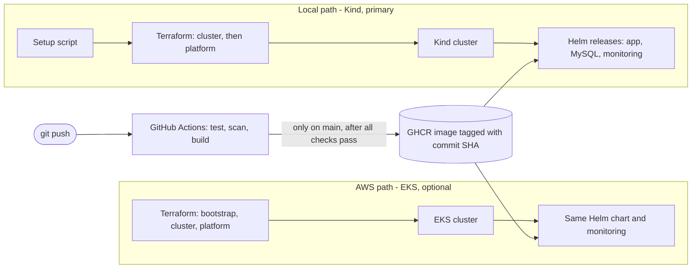
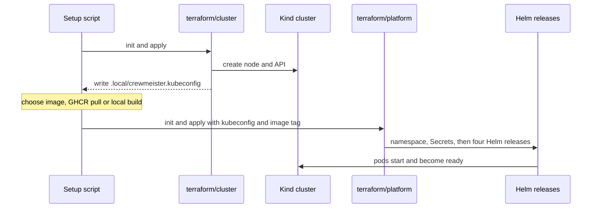
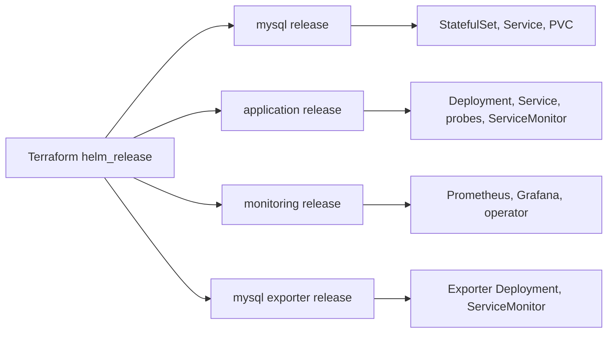
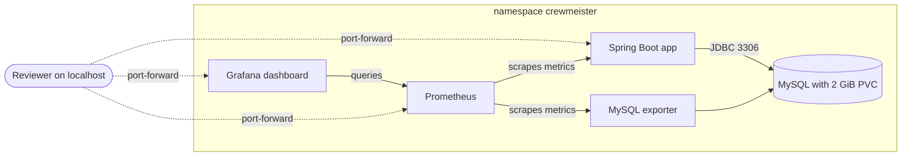
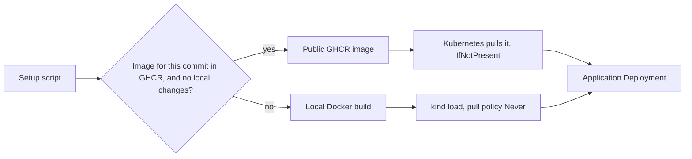
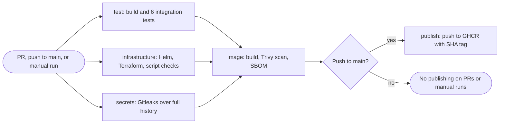
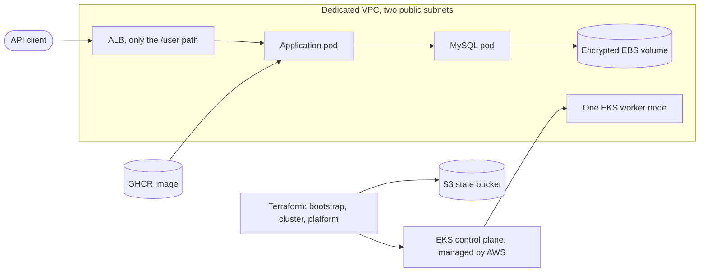
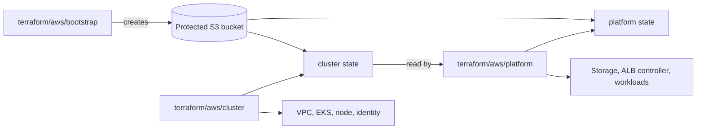

# Crewmeister DevOps challenge

A Java 17 / Spring Boot 3.5.16 user API, deployed on Kubernetes with Terraform and Helm, built and scanned by GitHub Actions, and monitored with Prometheus and Grafana. The same application chart runs on a **local Kind cluster** (free, the main path) and on **AWS EKS** (optional, shown in a video).

[](https://github.com/ouemnaa/crewmeister-devops-challenge/actions/workflows/ci.yml)

[Quick start](#quick-start-local) · [How it works](#how-it-works) · [CI pipeline](#ci-pipeline) · [AWS EKS](#aws-eks-optional) · [Limitations](#known-limitations-and-tested-platforms)

## Overview

| | Local: Kind (main path) | Cloud: AWS EKS (optional) |
| --- | --- | --- |
| Who runs it | You, with one script | The author, shown in the video below |
| Cost | Free, no cloud account | About $6 per day while running |
| Status | Tested on Windows 11 and WSL2 Ubuntu | Verified on 3 November 2026 from Windows; temporary |
| Start here | [Quick start](#quick-start-local) | [AWS EKS](#aws-eks-optional) |



<p align="center">
  <a href="https://youtu.be/O4EGeSubWZ8"></a>
  <br>
  <sub>▶ <a href="https://youtu.be/O4EGeSubWZ8">Watch the AWS EKS deployment on YouTube</a></sub>
</p>

## Requirements and where they are

| Assessment requirement | Implementation | Read next |
| --- | --- | --- |
| Dockerfile | [Dockerfile](Dockerfile): multi-stage build, pinned base images, non-root runtime | [Image delivery](#image-delivery) |
| Helm chart | [helm/crewmeister-app](helm/crewmeister-app): Deployment, Service, configuration, probes, ServiceMonitor | [Helm](#helm) |
| Terraform interacting with Kubernetes | [terraform/cluster](terraform/cluster) and [terraform/platform](terraform/platform): Kind, namespace, Secrets and Helm releases | [Terraform ownership](#terraform-ownership) |
| Any cloud provider | [terraform/aws](terraform/aws): AWS EKS extension with separate state | [AWS EKS (optional)](#aws-eks-optional) |
| Runs locally | [scripts](scripts): PowerShell and Bash setup, verification and teardown | [Quick start](#quick-start-local) |
| GitHub CI | [.github/workflows/ci.yml](.github/workflows/ci.yml): tests, validation, scans, gated image publishing | [CI pipeline](#ci-pipeline) |
| Monitoring | [monitoring](monitoring): Prometheus, MySQL exporter and provisioned Grafana dashboard | [Open monitoring](#3-open-monitoring) |

## Quick start (local)

**Tested:** Windows 11 Pro with Docker Desktop and WSL2 Ubuntu 22.04.5 with Docker Desktop integration. Native Linux, native macOS and Apple Silicon are untested. Use the same OS environment and checkout for setup, verification and teardown; Terraform state records native paths.

A recorded fresh Windows setup took **647.3 seconds, about 11 minutes**. Allow more time for downloads or a local image build. Allocate at least 4 CPUs and 6 GiB RAM to Docker; 8 GiB leaves more room during builds. Start Docker with Linux containers and allow access to GitHub, Maven Central, chart repositories and container registries.

| Prerequisite | Version used or required |
| --- | --- |
| Docker Desktop / Engine | Engine **28.0.4** tested; Linux containers required |
| Terraform | **1.15.8**, enforced by setup |
| Kind | **0.33.0**, enforced by setup |
| kubectl | **1.36.4** tested; clients **1.35–1.37** accepted |
| Helm | **4.3.1** |
| Git | **2.x**; no patch version is pinned |
| Windows shell | PowerShell **5.1+** |
| Bash path | Bash **5.1/5.2** tested and curl **7.81+**; WSL needs Docker Desktop integration |

Install binaries for your OS and CPU on `PATH`. Docker supplies Java 17 for image builds, so a host JDK is not needed for setup. Prefer cgroup v2; setup enables Kubernetes' documented cgroup-v1 compatibility setting when needed without changing the host.

| Access | Local port | Kubernetes port |
| --- | --- | --- |
| API | **18080** | 8080 |
| Grafana | **13000** | Service 80, container 3000 |
| Prometheus | **19090** | 9090 |
| MySQL / exporter | Internal only | 3306 / 9104 |
| Kind API | Random localhost port | Managed by Kind |

### 1. Create and verify the local environment

<details>
<summary>Windows PowerShell: check tools, clone, set up and verify</summary>

```powershell
terraform version
kind version
kubectl version --client
helm version --short
docker info --format '{{.OSType}}'

git clone https://github.com/ouemnaa/crewmeister-devops-challenge.git
cd crewmeister-devops-challenge
.\scripts\setup.ps1
.\scripts\verify.ps1
```

Docker must report `linux`. If script execution is blocked, use a separate PowerShell process, for example `powershell -ExecutionPolicy Bypass -File .\scripts\setup.ps1`; no machine-wide policy change is required.

</details>

<details>
<summary>WSL/Linux and macOS: check tools, clone, set up and verify</summary>

These Bash commands were exercised under WSL2 Ubuntu. The same script entry points are provided for native Linux and macOS, but those platforms have not been tested. Apple Silicon has no verified deployment path and the published image is amd64-only; do not assume these commands establish ARM64 support.

```bash
terraform version
kind version
kubectl version --client
helm version --short
docker info --format '{{.OSType}}'

git clone https://github.com/ouemnaa/crewmeister-devops-challenge.git
cd crewmeister-devops-challenge
bash scripts/setup.sh
bash scripts/verify.sh
```

Use Linux binaries inside WSL and enable Docker Desktop integration for that distribution.

</details>

Setup creates one Kind node and four releases: MySQL, application, monitoring and MySQL exporter. The local scripts apply Terraform automatically for this dedicated environment. They use `.local/crewmeister.kubeconfig` and context `kind-crewmeister`, leaving the default kubeconfig untouched.

<p align="center">
  <a href="docs/screenshots/local-setup-progress.png"></a>
  <br>
  <sub>Setup in progress: the MySQL volume is bound while Prometheus is still starting. Click to enlarge.</sub>
</p>

Verification checks nodes, workloads, storage, seeded GET, POST and persisted readback, health, metrics, Prometheus targets and the authenticated Grafana dashboard. It removes its test row and temporary port-forwards. It does not replace the separately recorded MySQL pod-recreation persistence test in [validation evidence](docs/validation.md).

### 2. Test the API

From the repository root, keep this command running in its own terminal. The `localhost` binding keeps the tunnel local to your machine.

```text
kubectl --kubeconfig .local/crewmeister.kubeconfig --context kind-crewmeister -n crewmeister port-forward --address localhost service/crewmeister-app 18080:8080
```

<details>
<summary>GET and POST from a second terminal</summary>

PowerShell:

```powershell
Invoke-RestMethod 'http://localhost:18080/user?id=1'
Invoke-RestMethod 'http://localhost:18080/user' -Method Post -ContentType 'application/json' -Body '{"name":"Reviewer"}'
```

Bash:

```bash
curl --fail 'http://localhost:18080/user?id=1'
curl --fail -H 'Content-Type: application/json' --data '{"name":"Reviewer"}' 'http://localhost:18080/user'
```

GET returns the seeded Alice greeting. POST persists the name and returns its greeting; it does not return the generated database ID. Use dummy data. Health and metrics paths are internal and unauthenticated for this exercise.

</details>

### 3. Open monitoring

Keep each command running in a separate terminal, from the repository root:

```text
kubectl --kubeconfig .local/crewmeister.kubeconfig --context kind-crewmeister -n crewmeister port-forward --address localhost service/crewmeister-grafana 13000:80
kubectl --kubeconfig .local/crewmeister.kubeconfig --context kind-crewmeister -n crewmeister port-forward --address localhost service/crewmeister-monitoring-prometheus 19090:9090
```

Open Grafana at **http://localhost:13000** and Prometheus at **http://localhost:19090**. If a port is occupied, change the local number before the colon and the URL to match.

<details>
<summary>Retrieve the generated Grafana password without printing it</summary>

The username is `admin`. There is no `admin/admin` default. In PowerShell, copy the password directly to the clipboard and paste it into the login form:

```powershell
$secret = kubectl --kubeconfig .local/crewmeister.kubeconfig --context kind-crewmeister -n crewmeister get secret crewmeister-grafana-admin -o json | ConvertFrom-Json
$grafanaPassword = [Text.Encoding]::UTF8.GetString([Convert]::FromBase64String($secret.data.'admin-password'))
Set-Clipboard -Value $grafanaPassword
Remove-Variable secret, grafanaPassword
```

Replace the clipboard contents with non-sensitive text after login. Do not display Secret contents or record the clipboard.

Bash can capture the password without printing it:

```bash
grafana_password="$(kubectl --kubeconfig .local/crewmeister.kubeconfig --context kind-crewmeister -n crewmeister get secret crewmeister-grafana-admin -o go-template --template='{{index .data "admin-password" | base64decode}}')"
```

Transfer the variable through your local clipboard utility, then `unset grafana_password`. OS-specific Bash clipboard integration is not validated by this repository; do not echo the password for a screenshot. WSL users can use the tested PowerShell clipboard procedure from Windows against the same checkout.

</details>

In Grafana, open **Dashboards → Crewmeister → Crewmeister application**. The eight panels cover availability, request rate, latency, HTTP errors, JVM memory, restarts and MySQL health and connections. Run API requests to generate traffic; rate panels need at least two scrapes.

In Prometheus, run `up{namespace="crewmeister",service="crewmeister-app"}` and `mysql_up{namespace="crewmeister",service="crewmeister-mysql-exporter"}`. Each should return `1`.

<table>
  <tr>
    <td align="center" valign="top"><a href="docs/screenshots/grafana-dashboard.png"></a><br><sub>Grafana dashboard with live data</sub></td>
    <td align="center" valign="top"><a href="docs/screenshots/prometheus-application-up.png"></a><br><sub>Prometheus: application UP</sub></td>
    <td align="center" valign="top"><a href="docs/screenshots/prometheus-mysql-up.png"></a><br><sub>Prometheus: MySQL UP</sub></td>
  </tr>
</table>

<sub>Click an image to enlarge.</sub>

### 4. Tear down the local environment

Stop manual port-forwards with Ctrl+C, then run the command for the OS environment used during setup:

```powershell
.\scripts\down.ps1
```

```bash
bash scripts/down.sh
```

Teardown destroys the platform before the Kind cluster and checks ownership and cluster identity. **This deletes the demonstration database.** Keep the checkout, state and dedicated kubeconfig until teardown finishes. Do not run lifecycle commands concurrently or delete state to work around a failure.

## How it works

### Terraform ownership

Local setup runs two Terraform stages in order. The cluster stage creates Kind and writes a dedicated kubeconfig. The platform stage reads that kubeconfig and installs everything on top.



Each stage keeps its own state: `terraform/cluster/terraform.tfstate` and `terraform/platform/terraform.tfstate`.

Terraform generates database and Grafana passwords at apply time. **State contains passwords in plaintext**, even when outputs are sensitive. State, plans, private inputs and kubeconfigs are ignored by Git and must stay private; provider lock files are committed.

### Helm

Terraform installs four Helm releases. The application chart is maintained in this repository; the others are pinned upstream charts. MySQL uses the official 8.4 image pinned by digest.



Upstream chart versions: MySQL **3.1.5**, kube-prometheus-stack **92.17.0**, prometheus-mysql-exporter **2.16.0**.

### Kubernetes runtime



Nothing is exposed publicly in the local setup: every Service is ClusterIP and you reach it through `kubectl port-forward`. MySQL stays internal. Its PVC survives pod replacement; namespace or cluster destruction removes the data. Prometheus storage is ephemeral with six-hour local retention, and shared values disable unused monitoring components to save resources.

The application runs as UID 10001, drops all capabilities, disallows privilege escalation and has a read-only root filesystem with writable `/tmp`. It receives no service-account token. Startup, liveness and database-aware readiness probes control rollout and traffic.

### Image delivery



The default image is `ghcr.io/ouemnaa/crewmeister-devops-challenge:<full-commit-SHA>`. Registry images use `IfNotPresent`; locally built, content-tagged images use `Never`. Only local builds pass through Kind's image import. A missing published tag falls back to a local build in the default `auto` mode.

`CREWMEISTER_IMAGE_MODE=local` forces a build; `registry` requires a published image with no fallback. `CREWMEISTER_IMAGE_TAG` and `CREWMEISTER_IMAGE_REPOSITORY` override selection. No deployment path uses `latest`.

## CI pipeline

[The workflow](.github/workflows/ci.yml) runs on pull requests targeting `main`, pushes to `main` and manual dispatch. The first three jobs run in parallel; image building waits for all three.



| Job | What it checks or produces | When it runs |
| --- | --- | --- |
| `test` (Build and test) | Java 17 build, six integration tests against disposable MySQL, test reports; optional SonarCloud step | Every trigger |
| `infrastructure` (Validate infrastructure) | Helm lint and render for local and AWS values, monitoring and dashboard checks, all five Terraform roots, PowerShell parsing and offline AWS guard tests, Bash syntax | Every trigger |
| `secrets` (Scan Git history for secrets) | Full-history Gitleaks scan; detected secrets fail the job, output is redacted | Every trigger |
| `image` (Build and scan image) | One Docker build, Trivy OS and Java reports, CycloneDX SBOM; scanner errors fail the job | After the first three jobs pass |
| `publish` (Publish image) | Publishes the already scanned image with the full commit SHA and checks anonymous GHCR access | Push to `main` only, after all earlier jobs pass |

Pull requests and manual runs cannot publish. Only `publish` has package-write permission. CI publishes a container image; it does not commit code or deploy Kubernetes or AWS. Actions and scanners are pinned to immutable revisions; Dependabot checks Actions, Docker and Maven weekly.

SonarCloud analyses the repository through its own GitHub integration, which needs no token and is separate from the workflow. The workflow also has an optional Sonar step inside `test`; it runs only on pushes to `main` when the required repository variables and token exist. The recorded pre-submission run skipped that step.

<p align="center">
  <a href="docs/screenshots/sonarcloud-analysis.png"></a>
  <br>
  <sub>SonarCloud: quality gate passed, one low-severity finding left open. Click to enlarge.</sub>
</p>

## AWS EKS (optional)

**Reviewers are not expected to deploy AWS.** The local quick start runs the whole assessment without cloud charges. AWS shows the same application and monitoring on a managed cluster, using the published image and the shared Helm chart.

<p align="center">
  <a href="https://youtu.be/O4EGeSubWZ8"></a>
  <br>
  <sub>▶ <a href="https://youtu.be/O4EGeSubWZ8">Watch the AWS EKS deployment</a></sub>
</p>

The AWS Terraform roots create a protected state bucket, a dedicated VPC with two public subnets, EKS, one On-Demand `m7i-flex.large` worker, Pod Identity associations, encrypted gp3 storage and the Helm workloads. Public API ingress adds an ALB. There is no NAT gateway. It is a single-node demonstration, so a node replacement or update interrupts every workload.



AWS uses three separate Terraform roots and never reuses the Kind states. Bootstrap keeps its own local state in `.local/aws/`; the cluster and platform roots keep theirs in the protected S3 bucket with native locking.



**Cost:** about **$0.25 per hour, or $6 per day**, with ingress, before credits, taxes, transfer and extra storage. This is a historical estimate, not a spending cap. Idle pods do not stop infrastructure charges.

**Status:** deployed and verified on **3 November 2026** from Windows PowerShell. The cluster is temporary because of its cost and will be destroyed after the review period; this video and the screenshots stay as evidence. The ordered teardown steps are in the AWS guide. A completed teardown and leftover audit are not yet recorded.

<table>
  <tr>
    <td align="center" valign="top"><a href="docs/screenshots/aws/aws-workload-status.png"></a><br><sub>EKS workloads running</sub></td>
    <td align="center" valign="top"><a href="docs/screenshots/aws/aws-running-pods.png"></a><br><sub>Application and monitoring pods</sub></td>
    <td align="center" valign="top"><a href="docs/screenshots/aws/aws-load-balancer.png"></a><br><sub>ALB: default 404, only /user routed</sub></td>
  </tr>
</table>

<sub>Click an image to enlarge.</sub>

**Access:** the EKS management endpoint is restricted to the administrator's IP. The API ingress accepts requests from any IPv4 address while the demo runs, and routes exactly `/user`, including query strings. Grafana and Prometheus are not exposed and use localhost port-forwarding. Public HTTP `/user` has no authentication and is meant only for temporary dummy data; health, metrics and monitoring paths return 404 through the ALB.

To run it in your own account, use a fresh checkout, your own temporary-credential profile, an account check, an operator role, private configuration and a unique backend bucket. Review costs, eligibility and every Terraform plan first. The [AWS deployment guide](docs/aws-deployment.md) covers setup, verification, monitoring and ordered teardown. Do not reuse someone else's private inputs or state. A full deployment from another account has not been validated.

## Design decisions

- **Two local Terraform stages:** the cluster exists before the Helm providers connect to it.
- **Full commit-SHA image tags:** each image maps to a source revision, and a local-build fallback keeps unpublished checkouts runnable.
- **CI publishes but does not deploy:** repository activity never triggers cloud changes or costs.
- **Kind for the local path:** reviewers can run Kubernetes without a cloud account.
- **Pod Identity on AWS:** the tested account blocked creation of an IAM OIDC provider, and Pod Identity gives each workload its own role without one.
- **Separate, protected S3 state on AWS:** cloud resources never share state with the local Kind setup.
- **Trivy is report-only:** inherited application vulnerabilities stay visible instead of being hidden, and scanner errors still fail CI.
- **SonarCloud through its GitHub integration:** analysis needs no token, so local reviewers need no extra setup.

## Known limitations and tested platforms

The recorded **3 November 2026** image scan found **2 CRITICAL**, 0 HIGH, 28 MEDIUM and 4 LOW findings. Both critical findings affect `org.springframework:spring-webmvc` **6.2.19**; Trivy lists **7.0.9** as fixed.

| Trivy finding | Status |
| --- | --- |
| CVE-2026-47884 | Open; no upgrade or suppression |
| CVE-2026-47890 | Open; no upgrade or suppression |

See [critical-finding details and upstream severity differences](docs/validation.md#critical-findings-unchanged). A major Spring Boot upgrade was not performed. A green CI run does not mean the image has no vulnerabilities; read the current CI artifacts for newer data.

- **Published architecture:** `linux/amd64` only. There is no published ARM64 image and no verified Apple Silicon deployment. CI publishes SHA tags, not release tags.
- **SonarCloud:** one low-severity "debug feature" finding in `UserController` is left open.
- **Network isolation:** no NetworkPolicies. ClusterIP Services do not restrict pod-to-pod access.
- **Availability and data:** one local node or one AWS worker, no high availability and no production backup workflow. MySQL data survives pod recreation but teardown deletes it. Monitoring storage is ephemeral.
- **Public API:** the optional AWS HTTP exposure has no application authentication and no TLS unless an existing certificate and domain are configured.
- **Credentials:** generated at deployment, stored in Kubernetes Secrets and plaintext Terraform state; private local files need protection.
- **Standalone chart:** its `local` image default is a development placeholder; setup supplies the real image and database settings.

| Platform or lifecycle | Recorded coverage |
| --- | --- |
| Windows 11 Pro + Docker Desktop | Fresh-clone local setup, verification and teardown passed on 3 November 2026 |
| WSL2 Ubuntu 22.04.5 + Docker Desktop | Earlier fresh-clone local lifecycle passed; not rerun in the latest audit |
| AWS from Windows PowerShell 5.1 | Existing partial deployment completed; application, EBS persistence, monitoring and public-path checks passed |
| Native Linux with standalone Docker Engine | **Untested** |
| Native macOS | **Untested** |
| Apple Silicon / ARM64 deployment | **Untested** |
| AWS lifecycle using Bash | **Untested live**; syntax and offline guard checks only |
| Fresh-account, fresh-clone full AWS lifecycle | **Untested**; recorded live work recovered an existing deployment |
| Independent second-network AWS HTTP check | **Untested**; security-group configuration was inspected |
| OS-specific Bash clipboard integration | **Untested** |
| Complete AWS teardown and leftover audit | **Not recorded as complete** |

## Repository layout

```text
Dockerfile                    Application container build
helm/crewmeister-app/         Application chart and local/AWS values
terraform/cluster/            Local Kind cluster stage
terraform/platform/           Local namespace, Secrets and releases
terraform/aws/                Separate bootstrap, cluster and platform roots
monitoring/                   Shared values, exporter and Grafana dashboard
scripts/                      PowerShell/Bash lifecycle and verification
.github/workflows/ci.yml      CI checks and gated GHCR publishing
src/                          Application, migrations and integration tests
docs/                         Assessment, validation, AWS guide and screenshots
```

More detail: the [original assessment](docs/assessment.md), the [validation evidence](docs/validation.md) and the [AWS deployment guide](docs/aws-deployment.md).
