# Crewmeister DevOps challenge

Run the Java 17 / Spring Boot 3.5.16 API, MySQL, Prometheus and Grafana on a local Kind cluster. Terraform creates Kubernetes and installs the Helm releases. The local path needs no cloud account; an optional AWS EKS deployment demonstrates the same application and monitoring on cloud infrastructure.

[](https://github.com/ouemnaa/crewmeister-devops-challenge/actions/workflows/ci.yml)

## Requirements and where they are

| Assessment requirement | Implementation | Read next |
| --- | --- | --- |
| Dockerfile | [Dockerfile](Dockerfile): multi-stage build, pinned base images, non-root runtime | [Image delivery](#image-delivery) |
| Helm chart | [helm/crewmeister-app](helm/crewmeister-app): Deployment, Service, configuration, probes, ServiceMonitor | [Kubernetes runtime](#kubernetes-runtime) |
| Terraform interacting with Kubernetes | [terraform/cluster](terraform/cluster) and [terraform/platform](terraform/platform): Kind, namespace, Secrets and Helm releases | [Terraform ownership](#terraform-ownership) |
| Any cloud provider | [terraform/aws](terraform/aws): AWS EKS extension with separate state | [AWS EKS (optional)](#aws-eks-optional) |
| Runs locally | [scripts](scripts): PowerShell and Bash setup, verification and teardown | [Quick start](#quick-start) |
| GitHub CI | [.github/workflows/ci.yml](.github/workflows/ci.yml): tests, validation, scans, gated image publishing | [CI pipeline](#ci-pipeline) |
| Monitoring | [monitoring](monitoring): Prometheus, MySQL exporter and provisioned Grafana dashboard | [Open monitoring](#3-open-monitoring) |

## Quick start

**Tested:** Windows 11 Pro with Docker Desktop and WSL2 Ubuntu 22.04.5 with Docker Desktop integration. Native Linux, native macOS and Apple Silicon are untested. Use the same OS environment and checkout for setup, verification and teardown; Terraform state records native paths.

A recorded fresh Windows setup took **647.3 seconds, about 11 minutes**. Allow more time for downloads or a local image build. Allocate at least 4 CPUs and 6 GiB RAM to Docker; 8 GiB leaves more room during builds. Start Docker with Linux containers and allow access to GitHub, Maven Central, chart repositories and container registries.

| Prerequisite | Version used or required |
| --- | --- |
| Docker Desktop / Engine | Engine **28.0.4** tested; Linux containers required |
| Terraform | **1.15.8**, enforced by setup |
| Kind | **0.33.0**, enforced by setup |
| kubectl | **1.36.4** tested; clients **1.35–1.37** accepted |
| Helm | **4.3.1** |
| Git | **2.x**; no patch version is pinned |
| Windows shell | PowerShell **5.1+** |
| Bash path | Bash **5.1/5.2** tested and curl **7.81+**; WSL needs Docker Desktop integration |

Install binaries for your OS and CPU on `PATH`. Docker supplies Java 17 for image builds, so a host JDK is not needed for setup. Prefer cgroup v2; setup enables Kubernetes' documented cgroup-v1 compatibility setting when needed without changing the host.

| Access | Local port | Kubernetes port |
| --- | --- | --- |
| API | **18080** | 8080 |
| Grafana | **13000** | Service 80, container 3000 |
| Prometheus | **19090** | 9090 |
| MySQL / exporter | Internal only | 3306 / 9104 |
| Kind API | Random localhost port | Managed by Kind |

### 1. Create and verify the local environment

<details>
<summary>Windows PowerShell: check tools, clone, set up and verify</summary>

```powershell
terraform version
kind version
kubectl version --client
helm version --short
docker info --format '{{.OSType}}'

git clone https://github.com/ouemnaa/crewmeister-devops-challenge.git
cd crewmeister-devops-challenge
.\scripts\setup.ps1
.\scripts\verify.ps1
```

Docker must report `linux`. If script execution is blocked, use a separate PowerShell process, for example `powershell -ExecutionPolicy Bypass -File .\scripts\setup.ps1`; no machine-wide policy change is required.

</details>

<details>
<summary>WSL/Linux and macOS: check tools, clone, set up and verify</summary>

These Bash commands were exercised under WSL2 Ubuntu. The same script entry points are provided for native Linux and macOS, but those platforms have not been tested. Apple Silicon has no verified deployment path and the published image is amd64-only; do not assume these commands establish ARM64 support.

```bash
terraform version
kind version
kubectl version --client
helm version --short
docker info --format '{{.OSType}}'

git clone https://github.com/ouemnaa/crewmeister-devops-challenge.git
cd crewmeister-devops-challenge
bash scripts/setup.sh
bash scripts/verify.sh
```

Use Linux binaries inside WSL and enable Docker Desktop integration for that distribution.

</details>

Setup creates one Kind node and four releases: MySQL, application, monitoring and MySQL exporter. The local scripts apply Terraform automatically for this dedicated environment. They use `.local/crewmeister.kubeconfig` and context `kind-crewmeister`, leaving the default kubeconfig untouched.

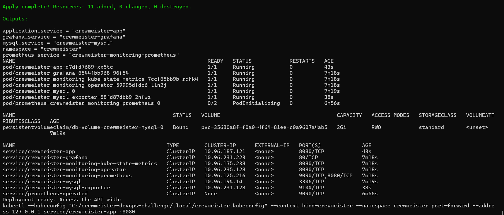

Local setup progress: the MySQL PVC is bound, while Prometheus is still initializing; verification establishes final readiness.

Verification checks nodes, workloads, storage, seeded GET, POST and persisted readback, health, metrics, Prometheus targets and the authenticated Grafana dashboard. It removes its test row and temporary port-forwards. It does not replace the separately recorded MySQL pod-recreation persistence test in [validation evidence](docs/validation.md).

### 2. Test the API

From the repository root, keep this command running in its own terminal. The `localhost` binding keeps the tunnel local to your machine.

```text
kubectl --kubeconfig .local/crewmeister.kubeconfig --context kind-crewmeister -n crewmeister port-forward --address localhost service/crewmeister-app 18080:8080
```

<details>
<summary>GET and POST from a second terminal</summary>

PowerShell:

```powershell
Invoke-RestMethod 'http://localhost:18080/user?id=1'
Invoke-RestMethod 'http://localhost:18080/user' -Method Post -ContentType 'application/json' -Body '{"name":"Reviewer"}'
```

Bash:

```bash
curl --fail 'http://localhost:18080/user?id=1'
curl --fail -H 'Content-Type: application/json' --data '{"name":"Reviewer"}' 'http://localhost:18080/user'
```

GET returns the seeded Alice greeting. POST persists the name and returns its greeting; it does not return the generated database ID. Use dummy data. Health and metrics paths are internal and unauthenticated for this exercise.

</details>

### 3. Open monitoring

Keep each command running in a separate terminal, from the repository root:

```text
kubectl --kubeconfig .local/crewmeister.kubeconfig --context kind-crewmeister -n crewmeister port-forward --address localhost service/crewmeister-grafana 13000:80
kubectl --kubeconfig .local/crewmeister.kubeconfig --context kind-crewmeister -n crewmeister port-forward --address localhost service/crewmeister-monitoring-prometheus 19090:9090
```

Open Grafana at **http://localhost:13000** and Prometheus at **http://localhost:19090**. If a port is occupied, change the local number before the colon and the URL to match.

<details>
<summary>Retrieve the generated Grafana password without printing it</summary>

The username is `admin`. There is no `admin/admin` default. In PowerShell, copy the password directly to the clipboard and paste it into the login form:

```powershell
$secret = kubectl --kubeconfig .local/crewmeister.kubeconfig --context kind-crewmeister -n crewmeister get secret crewmeister-grafana-admin -o json | ConvertFrom-Json
$grafanaPassword = [Text.Encoding]::UTF8.GetString([Convert]::FromBase64String($secret.data.'admin-password'))
Set-Clipboard -Value $grafanaPassword
Remove-Variable secret, grafanaPassword
```

Replace the clipboard contents with non-sensitive text after login. Do not display Secret contents or record the clipboard.

Bash can capture the password without printing it:

```bash
grafana_password="$(kubectl --kubeconfig .local/crewmeister.kubeconfig --context kind-crewmeister -n crewmeister get secret crewmeister-grafana-admin -o go-template --template='{{index .data "admin-password" | base64decode}}')"
```

Transfer the variable through your local clipboard utility, then `unset grafana_password`. OS-specific Bash clipboard integration is not validated by this repository; do not echo the password for a screenshot. WSL users can use the tested PowerShell clipboard procedure from Windows against the same checkout.

</details>

In Grafana, open **Dashboards → Crewmeister → Crewmeister application**. The eight panels cover availability, request rate, latency, HTTP errors, JVM memory, restarts and MySQL health/connections. Run API requests to generate traffic; rate panels need at least two scrapes.

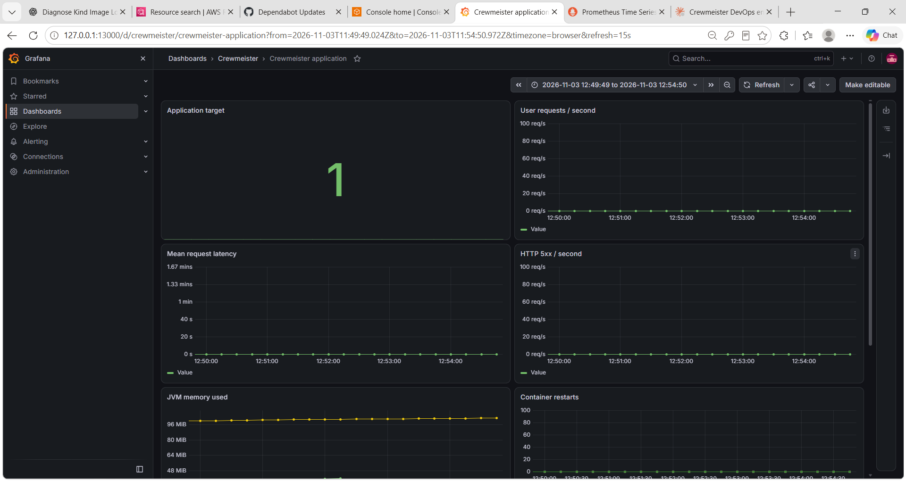

Grafana snapshot with live application and JVM data from the recorded local deployment.

In Prometheus, run `up{namespace="crewmeister",service="crewmeister-app"}` and `mysql_up{namespace="crewmeister",service="crewmeister-mysql-exporter"}`. Each should return `1`.

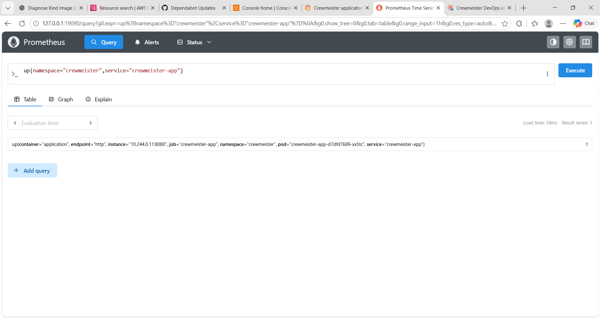

Application scrape snapshot: Prometheus reports the application target UP.

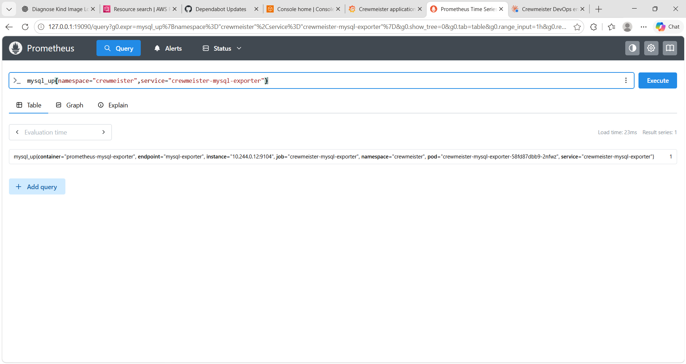

Database scrape snapshot: the exporter reports MySQL UP.

### 4. Tear down the local environment

Stop manual port-forwards with Ctrl+C, then run the command for the OS environment used during setup:

```powershell
.\scripts\down.ps1
```

```bash
bash scripts/down.sh
```

Teardown destroys the platform before the Kind cluster and checks ownership and cluster identity. **This deletes the demonstration database.** Keep the checkout, state and dedicated kubeconfig until teardown finishes. Do not run lifecycle commands concurrently or delete state to work around a failure.

## Architecture

### Overview

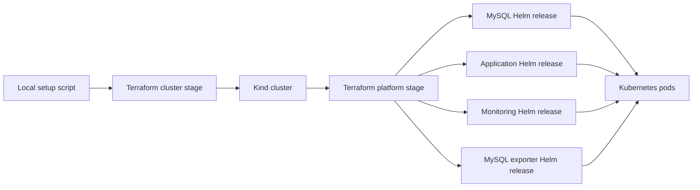

The upstream charts are MySQL **3.1.5**, kube-prometheus-stack **92.17.0** and prometheus-mysql-exporter **2.16.0**. MySQL uses the official 8.4 image pinned by digest. The application chart is maintained in this repository.

### Terraform ownership

Local stages own separate resources and state. The platform stage starts after cluster creation and image selection.

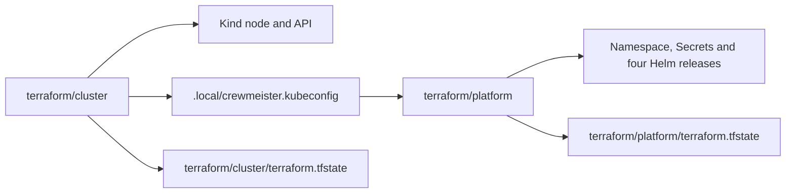

AWS adds a bootstrap root and uses independent state keys; it never reuses the Kind states.

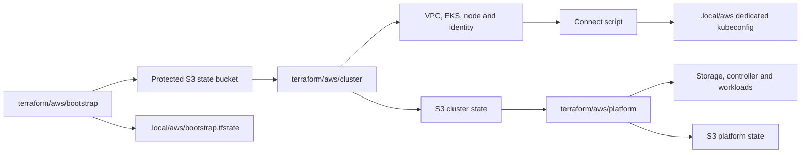

Terraform generates database and Grafana passwords at apply time. **State contains passwords in plaintext**, even when outputs are sensitive. State, plans, private inputs and kubeconfigs are ignored by Git and must stay private; provider lock files are committed.

### Kubernetes runtime

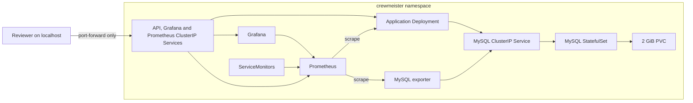

No local Service is publicly exposed. MySQL stays internal. Its PVC survives pod replacement; namespace or cluster destruction removes the data. Prometheus storage is ephemeral with six-hour local retention. Shared values disable unused monitoring components to reduce resource use.

The application runs as UID 10001, drops all capabilities, disallows privilege escalation and has a read-only root filesystem with writable `/tmp`. It receives no service-account token. Startup, liveness and database-aware readiness probes control rollout and traffic.

### Image delivery

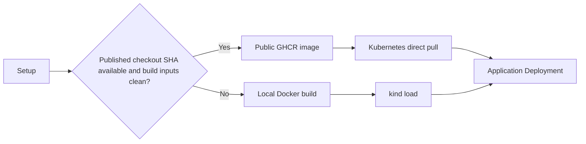

The default image is `ghcr.io/ouemnaa/crewmeister-devops-challenge:<full-commit-SHA>`. Registry images use `IfNotPresent`; locally built, content-tagged images use `Never`. Only local builds pass through Kind's image import. Missing published tags fall back to a local build in default `auto` mode.

`CREWMEISTER_IMAGE_MODE=local` forces a build; `registry` requires a published image without fallback. `CREWMEISTER_IMAGE_TAG` and `CREWMEISTER_IMAGE_REPOSITORY` override selection. No deployment path uses `latest`.

## Screenshots

Screenshots sit beside the setup, monitoring, CI and AWS steps they illustrate. Filenames use lowercase kebab-case. AWS account IDs are masked; other image pixels are unchanged, including browser chrome and resource addresses. No screenshot establishes the current status of a running environment.

## CI pipeline

[The workflow](.github/workflows/ci.yml) runs on pull requests targeting `main`, pushes to `main` and manual dispatch. The first three jobs run in parallel; image building waits for all three.

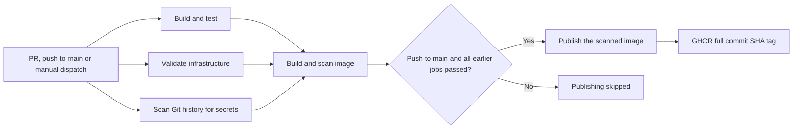

| Job | What it checks or produces | When it runs |
| --- | --- | --- |
| `test` — Build and test | Java 17 build, six integration tests against disposable MySQL, test reports; optional SonarCloud step | Every trigger |
| `infrastructure` — Validate infrastructure | Helm lint/render for local and AWS values, monitoring/dashboard checks, all five Terraform roots, PowerShell parsing and offline AWS guard tests, Bash syntax | Every trigger |
| `secrets` — Scan Git history for secrets | Full-history Gitleaks scan; detected secrets fail the job, output is redacted | Every trigger |
| `image` — Build and scan image | One Docker build, Trivy OS/Java reports and CycloneDX SBOM; scanner errors fail the job | After the first three jobs pass |
| `publish` — Publish image | Publishes the already scanned image with the full commit SHA and checks anonymous GHCR access | Push to `main` only, after all earlier jobs pass |

Pull requests and manual runs cannot publish. Only `publish` has package-write permission. CI publishes a container image; it does not commit code to the repository or deploy Kubernetes/AWS. Actions and scanners are pinned to immutable revisions; Dependabot checks Actions, Docker and Maven weekly.

SonarCloud is an optional **step inside `test`**, enabled only on pushes to `main` with the required repository variables and token. Missing configuration skips it. The recorded pre-submission run skipped this step; the separate screenshot below shows a SonarCloud analysis snapshot, not proof that this CI step ran.

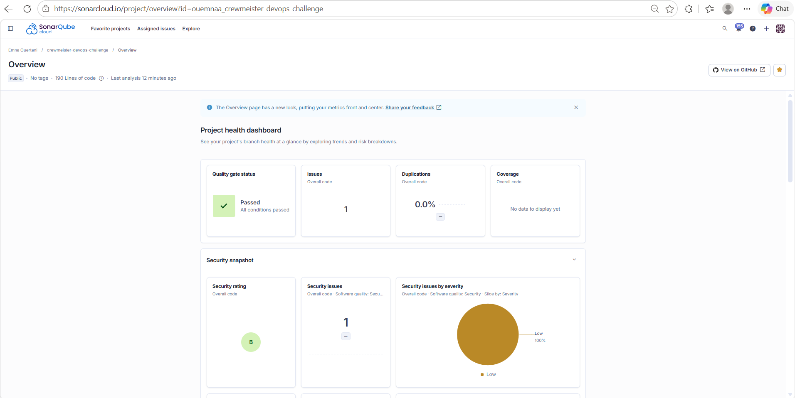

SonarCloud snapshot: the gate passed, but one low-severity security issue remains visible; its rule and resolution are not recorded here.

## AWS EKS (optional)

**Reviewers are not expected to deploy AWS.** Use the local quick start to run the assessment without cloud charges. AWS demonstrates a separate deployment using the published application image and shared monitoring configuration.

The AWS roots create a protected state bucket, a dedicated VPC with two public subnets, EKS, one On-Demand `m7i-flex.large` worker, Pod Identity associations, encrypted gp3 storage and the Helm workloads. Public application ingress adds an ALB. There is no NAT gateway. This is a single-node demonstration, with interruptions during replacement or updates.

**Cost:** the guide records about **$0.25/hour or $6/day** with ingress, before credits, taxes, transfer and extra storage/requests. This is a historical estimate, not a spending cap. Idle pods do not stop infrastructure charges.

**Lifecycle status:** live Windows acceptance is recorded on **3 November 2026**. The demo is intended to remain available for about two weeks; availability is temporary. No destruction date or completed leftover audit is recorded in the repository, so this README does not claim teardown has passed.

[](https://youtu.be/O4EGeSubWZ8)

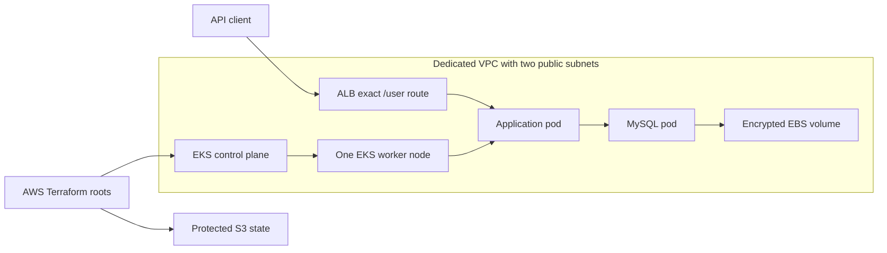

**Check EKS workload status:** the recorded console view shows running Deployments, DaemonSets and StatefulSets.

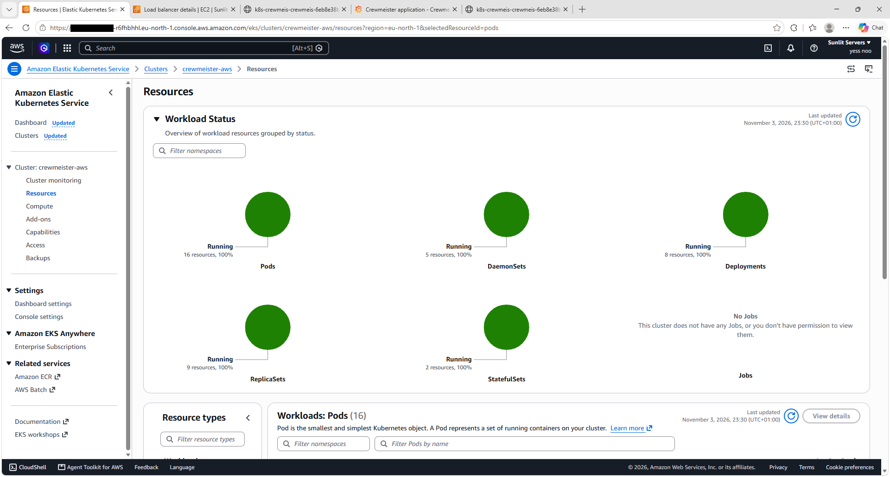

AWS workload summary from the recorded deployment; browser tabs and AWS console resource URLs remain visible.

**Check the application and monitoring pods:** the recorded pod list includes the API, database, exporter and Grafana.

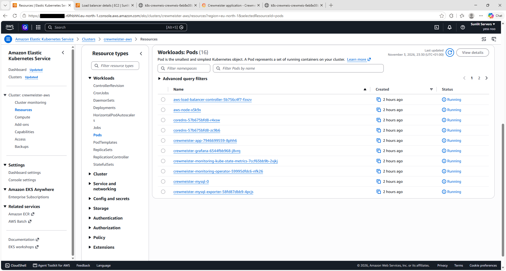

AWS pod list from the recorded deployment; browser tabs and console resource URLs remain visible.

**Check ingress:** the ALB listener uses a default fixed 404 response; the application rule permits exactly `/user`, including query strings.

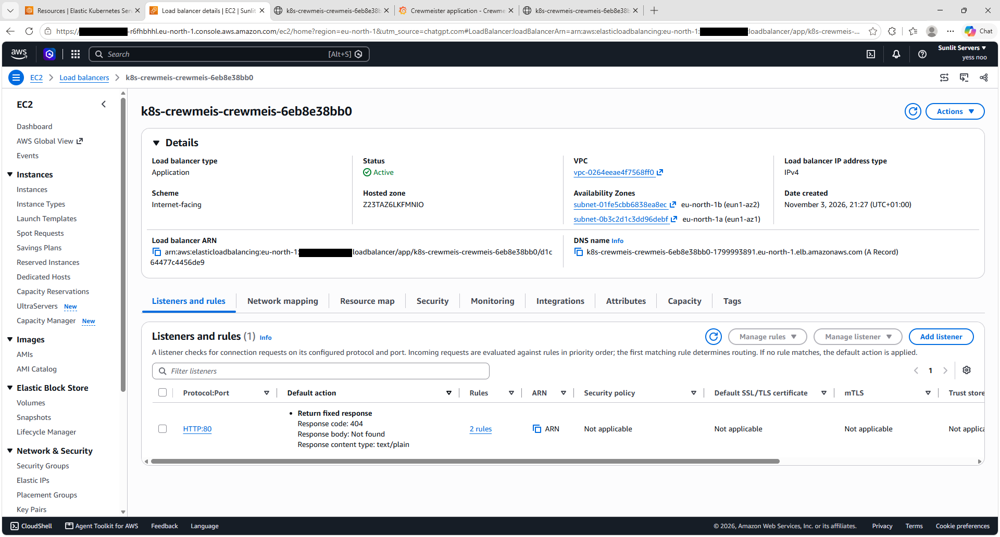

ALB evidence from the recorded deployment; browser tabs, resource identifiers and the load-balancer hostname remain visible in the original capture.

The **EKS management endpoint remains restricted to the administrator's IP**. Application ingress initially used an IP restriction, then the owner enabled worldwide IPv4 access explicitly. Grafana and Prometheus remain private and use localhost port-forwarding. Public HTTP `/user` has no authentication and is intended only for temporary dummy data; management and monitoring paths return 404 through the ALB.

For another account, use a fresh checkout, your own temporary-credential profile, account confirmation, operator role, private configuration and unique backend bucket. Review costs, eligibility and each Terraform plan. Follow [the AWS deployment guide](docs/aws-deployment.md) for setup, verification, monitoring and ordered teardown; do not reuse someone else's private inputs or state. Full deployment on another account has not been validated.

## Design decisions

- Two local Terraform stages create the cluster before configuring Helm, so Kubernetes exists when the platform providers connect.
- Full commit-SHA image tags identify the source revision, while a local-build fallback keeps unpublished checkouts runnable.
- CI publishes the scanned image without deploying it, so repository activity does not trigger cloud changes or costs.
- Kind provides the primary local platform because reviewers can run Kubernetes without a cloud account.
- AWS workloads use Pod Identity because the tested account blocked IAM OIDC-provider creation and Pod Identity supports separate workload roles.
- AWS uses separate, protected S3 state with native locking so cloud resources do not share local Kind state.
- Trivy findings remain report-only to expose inherited application vulnerabilities without hiding them; scanner errors still fail CI.
- SonarCloud is an optional step in the build/test job because analysis needs repository configuration and a token that local reviewers do not need.

## Known limitations and tested platforms

The recorded **3 November 2026** image scan found **2 CRITICAL**, 0 HIGH, 28 MEDIUM and 4 LOW findings. Both critical findings affect `org.springframework:spring-webmvc` **6.2.19**; Trivy lists **7.0.9** as fixed.

| Trivy finding | Status |
| --- | --- |
| CVE-2026-47884 | Open; no upgrade or suppression |
| CVE-2026-47890 | Open; no upgrade or suppression |

See [critical-finding details and upstream severity differences](docs/validation.md#critical-findings-unchanged). A major Spring Boot upgrade was not performed. Read current CI artifacts for newer vulnerability data; a green CI run does not mean the image has no vulnerabilities.

- **Published architecture:** `linux/amd64` only; no published ARM64 image or verified Apple Silicon deployment. CI publishes SHA tags, not release/version tags.
- **SonarCloud:** the supplied snapshot shows one low-severity security issue; its rule, fix status and current live analysis are unverified.
- **Network isolation:** no NetworkPolicies. ClusterIP Services do not provide pod-to-pod access restrictions.
- **Availability and data:** one local node or one AWS worker, no high availability or production backup workflow; MySQL data survives pod recreation but teardown deletes it. Monitoring storage is ephemeral.
- **Public API:** optional AWS HTTP exposure has no application authentication or TLS unless an existing certificate/domain is configured.
- **Credentials:** generated at deployment, stored in Kubernetes Secrets and plaintext Terraform state; local private files require protection.
- **Standalone chart:** its `local` image default is a development placeholder; setup supplies the actual image and database settings.

| Platform or lifecycle | Recorded coverage |
| --- | --- |
| Windows 11 Pro + Docker Desktop | Fresh-clone local setup, verification and teardown passed on 3 November 2026 |
| WSL2 Ubuntu 22.04.5 + Docker Desktop | Earlier fresh-clone local lifecycle passed; not rerun in the latest audit |
| AWS from Windows PowerShell 5.1 | Existing partial deployment completed; application, EBS persistence, monitoring and public-path checks passed |
| Native Linux with standalone Docker Engine | **Untested** |
| Native macOS | **Untested** |
| Apple Silicon / ARM64 deployment | **Untested** |
| AWS lifecycle using Bash | **Untested live**; syntax/offline guard checks only |
| Fresh-account / fresh-clone full AWS lifecycle | **Untested**; recorded live work recovered an existing deployment |
| Independent second-network AWS HTTP check | **Untested**; security-group configuration was inspected |
| OS-specific Bash clipboard integration | **Untested** |
| Complete AWS teardown and leftover audit | **Not recorded as complete** |

## Repository layout

```text
Dockerfile                    Application container build
helm/crewmeister-app/         Application chart and local/AWS values
terraform/cluster/            Local Kind cluster stage
terraform/platform/           Local namespace, Secrets and releases
terraform/aws/                Separate bootstrap, cluster and platform roots
monitoring/                   Shared values, exporter and Grafana dashboard
scripts/                      PowerShell/Bash lifecycle and verification
.github/workflows/ci.yml       CI checks and gated GHCR publishing
src/                          Application, migrations and integration tests
docs/                         Assessment, validation, AWS guide and screenshots
```

Read the [original assessment](docs/assessment.md), [validation evidence](docs/validation.md) and [AWS deployment guide](docs/aws-deployment.md) for scope, executed checks and detailed cloud operations.
