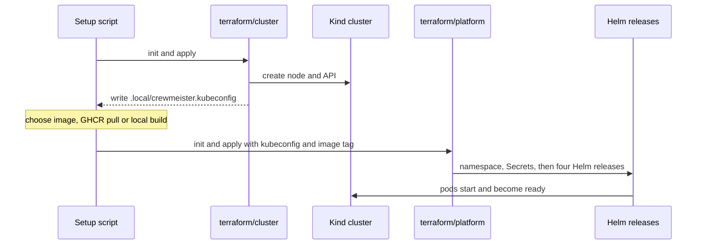
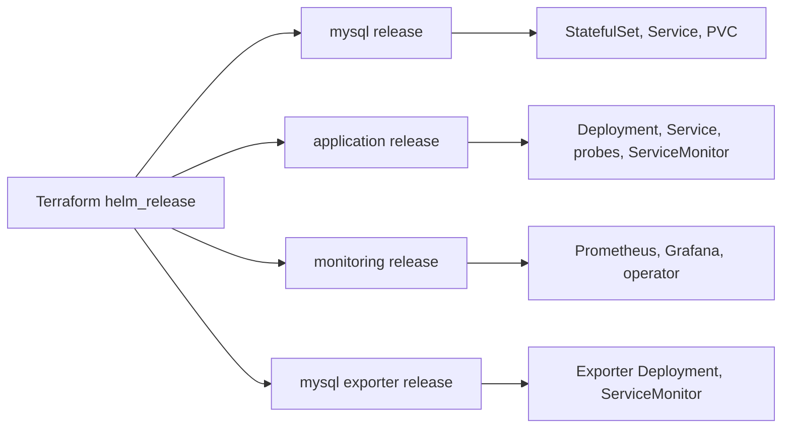
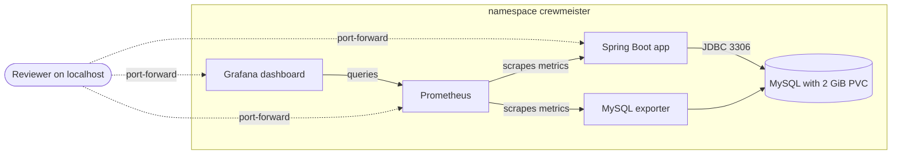
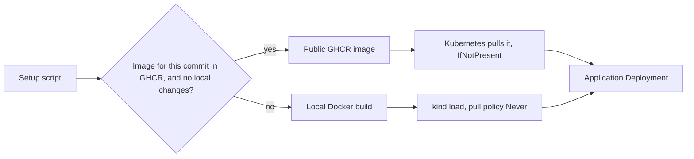
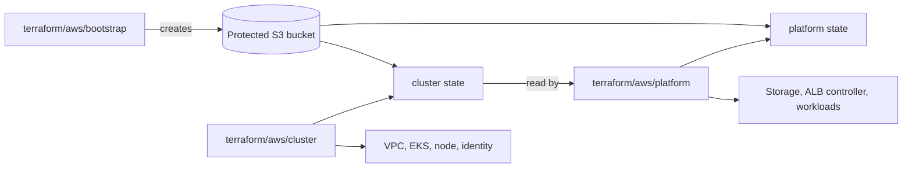

# Technical architecture diagrams

These additional diagrams expand on the [Crewmeister DevOps challenge README](../README.md). The README keeps only the project overview, CI pipeline, and optional AWS EKS architecture diagrams to stay easy to scan.

## Local Terraform setup sequence

The PowerShell and Bash setup scripts manage the lifecycle of two separate local Terraform roots. The platform stage runs only after Kind is ready.

State is isolated: `terraform/cluster/terraform.tfstate` and `terraform/platform/terraform.tfstate`. Never point the Kind platform root or its state at AWS.

## Helm releases and resources

The Terraform platform root installs four releases with dependency-aware ordering. The custom application chart remains shared by Kind and AWS.

Pinned upstream charts: MySQL `3.1.5`, kube-prometheus-stack `92.17.0`, and prometheus-mysql-exporter `2.16.0`.

## Local Kubernetes runtime

Application traffic, database storage, monitoring scrapes, and localhost access are isolated within the `crewmeister` namespace.

In the local Kind environment, all Kubernetes Services are ClusterIP. Application, Grafana and Prometheus access uses localhost port-forwarding. MySQL storage is persistent across pod replacement, but teardown removes the demo data.

## Local image selection and delivery

For a clean checkout matching a published image, Kind can pull the public GHCR image tagged with the exact commit SHA. Otherwise, the local setup can build and import a new image.

`CREWMEISTER_IMAGE_MODE=local` forces local build and load; `registry` requires the published image; `auto` selects between them. Local images use pull policy `Never`, whereas published images use `IfNotPresent`.

## AWS state and dependency flow

The AWS extension uses three Terraform roots, entirely separate from Kind. The bootstrap backend is protected locally, while the cluster and platform use separate locked S3 state keys.

- Bootstrap: protected local state under `.local/aws/`, backed up separately.
- Cluster: `crewmeister/aws/cluster.tfstate` in the private S3 backend.
- Platform: `crewmeister/aws/platform.tfstate` in that backend, with a different key.

The platform reads the AWS cluster state to connect Helm/Kubernetes providers to the correct EKS cluster. Apply bootstrap → cluster → platform; remove public ingress and platform resources before destroying the cluster. Keep S3 state until cleanup has been verified. Refer to [the AWS deployment guide](aws-deployment.md) for safeguards and controlled teardown procedures.
